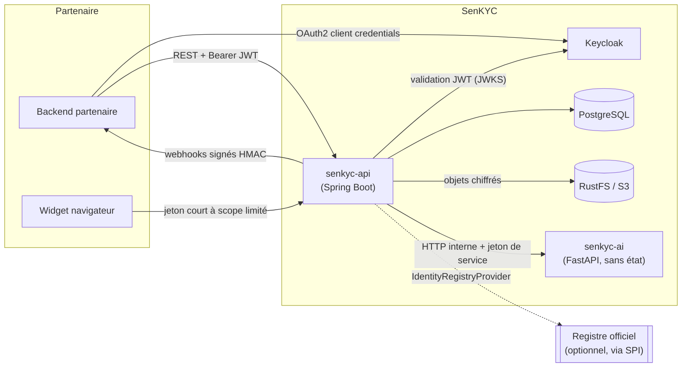

# Architecture SenKYC — socle (semaine 1)

## 1. Vue d'ensemble

Deux processus applicatifs seulement :

- **senkyc-api** — monolithe modulaire Java 21 / Spring Boot. Seul point d'entrée public : API REST,
  authentification, multi-tenant, workflow, décision, webhooks, audit.
- **senkyc-ai** — service Python/FastAPI **sans état**, limité à l'inférence et au traitement d'image.
  Aucun accès à la base ni au stockage objet ; non exposé hors du réseau interne.

Infrastructure : PostgreSQL (données métier + base Keycloak), Keycloak (IAM), RustFS (objets S3
chiffrés : CNI, selfies). RabbitMQ n'est **pas** introduit : aucun besoin asynchrone avéré à ce stade
(voir ADR 0003).



## 2. Monolithe modulaire et hexagonal pragmatique

Un **seul module Maven applicatif** (`senkyc-api`), organisé en packages par domaine
(`sn.senkyc.api.<module>`). Chaque module métier suivra la forme :

```
<module>/
  domain/        modèle et règles métier (aucune dépendance Spring/JPA)
  application/   cas d'usage + ports (interfaces) entrantes/sortantes
  adapter/
    in/web/      contrôleurs REST, DTO
    out/...      persistance JPA, client IA, stockage, registre
```

Modules cibles : `identity-verification`, `document-processing`, `biometric-verification`,
`verification-workflow`, `decision-engine`, `registry-connector`, `tenant-management`,
`webhook-management`, `audit`, `security`. Les frontières seront vérifiées par des tests
d'architecture (ArchUnit) dès que deux modules existeront (semaine 3).

Semaine 1 : seul le package transverse `platform` existe (`web`, `security`, `ai`) ; aucun module
métier vide n'a été créé.

## 3. Découpage Maven

```
senkyc-parent (pom, parent = spring-boot-starter-parent)
├── packages/senkyc-registry-spi   jar sans dépendance runtime (contrat IdentityRegistryProvider)
└── apps/senkyc-api                jar exécutable Spring Boot
```

Pourquoi pas un module Maven par domaine : coût de build et de configuration élevé pour un seul
déploiement. Les SDK Java/TS, le widget et la console (semaines 9-11) sont des artefacts distincts
et seront ajoutés au moment voulu (`senkyc-java-sdk` rejoindra le reactor Maven).
`senkyc-document-sn` (règles propres à la CNI sénégalaise) est prévu en semaine 4/5.

## 4. Modèle de données initial

Voir [data-model.md](data-model.md). Implémenté dans
`apps/senkyc-api/src/main/resources/db/changelog/changes/001-initial-schema.sql`.

## 5. Authentification et autorisation

Voir [ADR 0004](../adr/0004-authentification-keycloak.md). Résumé :

- Partenaires serveur → API : OAuth2 **client credentials** Keycloak, JWT validé par l'API
  (resource server, semaine 2). Le claim `tenant_id` identifie le tenant.
- Widget : jeton court (quelques minutes) à usage unique, limité à **une** vérification et aux
  actions de capture ; émis par l'API pour le compte du partenaire. Jamais de secret dans le navigateur.
- État actuel (semaine 1) : **tout est refusé (401) sauf `/actuator/health`**.

## 6. Communication Java ↔ Python

Voir [ADR 0003](../adr/0003-service-ia-http-interne.md). Résumé :

- HTTP/JSON synchrone sur le réseau interne ; `RestClient` côté Java derrière le port `AiServiceClient`.
- Authentification service-à-service par jeton Bearer partagé (`SENKYC_AI_INTERNAL_TOKEN`) comparé
  en temps constant ; **fail-closed** : sans jeton configuré, `/v1/*` répond 503.
- `X-Correlation-Id` propagé de bout en bout ; timeouts explicites (connexion 2 s, lecture 5 s).
- Les images seront envoyées **en octets** par l'API (jamais d'URL à récupérer côté IA : pas de SSRF,
  pas d'identifiants S3 dans le service IA). Le service IA ne persiste ni ne journalise aucune image.
- Appel réel en semaine 1 : l'indicateur de santé `aiService` appelle `GET /v1/info`.
  Le service IA est dans le groupe de santé *readiness* de l'API.

## 7. Sécurité — état de la semaine 1

| Mesure | État |
|---|---|
| Deny-by-default HTTP, réponses 401 | en place + testé |
| Pas de secret par défaut (DB, jeton IA) : démarrage impossible sans | en place |
| Détails d'erreur/santé masqués | en place |
| Correlation ID validé (anti-injection de logs) | en place + testé |
| `toString()` masquant jeton et données personnelles | en place + testé |
| Conteneurs non-root, ports sensibles liés à 127.0.0.1, service IA non publié | en place |
| OAuth2 resource server (signature, `iss`, `aud`, expiration, `tenant_id`), autorisation par rôle/scope | en place, tests écrits ; **non exécutés** au moment de l'écriture |
| RLS PostgreSQL + rôle applicatif sans DDL, journal d'audit en ajout seul | en place, tests d'intégration écrits ; **non exécutés** au moment de l'écriture |
| Chiffrement des objets, rate limiting | semaines 3+ |

La conformité réglementaire (données personnelles, biométrie) **n'est pas acquise** par ces mesures
techniques ; la documentation dédiée sera produite et devra être revue par un juriste/DPO.
