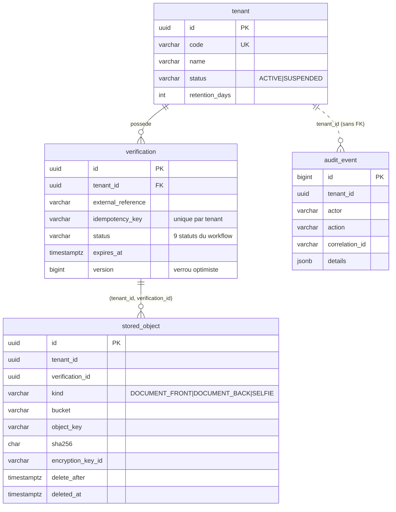

# Modèle de données initial

Aucune donnée personnelle extraite de la CNI n'est stockée à ce stade. Les champs OCR seront ajoutés
(chiffrés au niveau applicatif) en semaine 4. Les images ne sont **jamais** en base : seules des
métadonnées pointent vers l'objet chiffré dans MinIO.

Choix notables :

- **Isolation** : `tenant_id` partout ; clé étrangère composite `(tenant_id, verification_id)` qui
  interdit à l'échelle de la base de rattacher un objet à la vérification d'un autre tenant (testé
  dans `SenkycApiApplicationIT`). Row-Level Security PostgreSQL : semaine 2.
- **Statuts** : contrainte `CHECK` alignée sur les 9 statuts du cahier des charges.
- **Idempotence** : index unique partiel `(tenant_id, idempotency_key)`.
- **Rétention** : `stored_object.delete_after` + index partiel pour le job de purge ;
  `tenant.retention_days` vaut 30 par défaut **à titre provisoire** (à valider juridiquement).
- **Audit** : pas de FK vers `tenant`, pour survivre à sa suppression. L'append-only sera appliqué
  par les privilèges du rôle applicatif (INSERT seul) en semaine 2.
- **Rôles BD** : en semaine 1 l'application utilise le rôle propriétaire ; un rôle applicatif
  sans droits DDL sera créé en semaine 2 avec la RLS.
